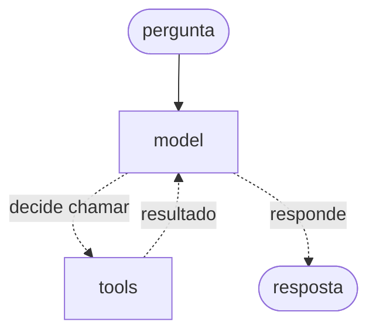

# Agente Estudante × Universidade — LangChain e LangGraph

Um agente de IA, de uso interno para uma equipe de orientação acadêmica, que consulta fichas de alunos e universidades, compara, recomenda e responde dúvidas de admissão.

O projeto é contado **em fases**: começa no agente como ensinado no curso, mede onde ele erra, corrige com ferramentas determinísticas e regras, e mede de novo. A fase de segurança fica para o próximo repositório.

Funciona com **OpenAI, Gemini ou Anthropic**, em **LangChain 1.x / LangGraph 1.x**.

```text
> Pode listar as diferenças entre a Bianca e o Gabriel?

  · o modelo decidiu chamar comparar_estudantes(nomes=['Bianca', 'Gabriel'])
  ·   comparei as fichas: Bianca, Gabriel
  ·   média geral: Bianca 7.4, Gabriel 7.5
  ·     quimica: Bianca 7.0 × Gabriel 8.0 (lidera: Gabriel)
  ·     atividades_sociais: Bianca 4.0 × Gabriel 3.0 (lidera: Bianca)
  ·     areas_interesse em comum: Exatas
  ·     paises_preferidos em comum: Brasil
  · redigindo a resposta

- Gabriel lidera em física, química, biologia, projetos e publicações
- Bianca lidera em computação, português, filosofia, atividades sociais, inglês e espanhol
- Empatam em matemática, história e alemão
...
```

As linhas com `·` são o processamento: o que o modelo decidiu e o que cada ferramenta devolveu. O resto é a resposta.

---

## As fases

| Fase | O que é | Pasta |
|---|---|---|
| **1. Curso** | o agente do curso: 4 ferramentas, busca exata, o LLM compara e recomenda "de cabeça" | [`fases/fase1_curso`](fases/fase1_curso/) |
| **2. Ferramentas e regras** | tudo que pode ser calculado vira ferramenta em Python; regras de domínio e de resposta; registro das conversas | [`fases/fase2_ferramentas`](fases/fase2_ferramentas/) |
| **3. Segurança** | ferramentas destrutivas, cargos, prompt injection, confirmação humana e orquestrador em Python | [`fases/fase3_seguranca`](fases/fase3_seguranca/) — próximo repo |

Cada fase é medida pelo mesmo script ([`verificar_variacao.py`](#verificação-o-mesmo-prompt-respostas-diferentes)), que roda as mesmas perguntas 10 vezes e grava o relatório em [`docs/verificacoes/`](docs/verificacoes/).

### Resultado (claude-haiku-5-5, 10 execuções por pergunta)

| Pergunta | Fase 1 | Fase 2 |
|---|---|---|
| Quais os dados da uni comp? | 30/40 | 40/40 |
| Compare a Ana com a Bianca | 10/30 | 30/30 |
| Pode listar as diferenças entre a Bianca e o Gabriel? | 24/40 | 39/40 |
| Qual faculdade combina mais com o Gabriel? | 22/40 | 40/40 |
| Como funciona o ingresso no ITA? | 19/30 | 30/30 |
| **Total** | **105/180** | **179/180** |

Parte das falhas da fase 1 é estrutural: ela não tem ferramenta de comparação, ranking nem guias, então o modelo responde "de cabeça". No ITA, a fase 1 tomou 4 caminhos de ferramentas diferentes em 10 execuções e respondeu com conhecimento geral; a fase 2 usou o guia nas 10. Relatórios completos: [`fase1`](docs/verificacoes/) e [`fase2`](docs/verificacoes/).

O modelo também pesa: numa rodada anterior com `gemini-3.5-flash-lite`, a fase 1 inventou detalhes do vestibular do ITA que não estão nos guias (inspeção de saúde, regras de carreira militar), com toda a confiança, e a fase 2 respondeu em texto corrido a 6 de 10 pedidos de lista. Com o Haiku, foi 1 de 10.

---

## Como o agente funciona (fase 2)



O `create_agent` monta esse laço: o **modelo** decide qual ferramenta chamar; as **ferramentas** (Python) executam e devolvem JSON; o modelo lê e decide de novo, até responder.

| Ferramenta | Recebe | Devolve |
|---|---|---|
| `dados_estudante` | nome (tolera erro de digitação) | ficha do aluno |
| `dados_universidade` | sigla, nome ou apelido | ficha da universidade |
| `listar_universidades` | nada | sigla, país e idioma de todas |
| `comparar_estudantes` | 2+ nomes | valores campo a campo, quem lidera, diferença, em comum |
| `comparar_universidades` | 2+ siglas | idem para universidades |
| `ranquear_universidades` | aluno (+ universidades opcionais) | score 0–100 com componentes |
| `perfil_academico` | aluno | perfil escrito pelo LLM |
| `consultar_guias_admissao` | pergunta (+ universidade) | trechos dos guias de admissão (RAG) |
| `consultar_historico` | pergunta | trechos de conversas anteriores (RAG) |

**O que é Python e o que é LLM:** buscas, comparações, ranking e RAG são Python, sempre iguais para a mesma entrada. O LLM decide **qual ferramenta chamar** e **escreve o texto**. Só `perfil_academico` usa o LLM dentro de uma ferramenta.

### O score de compatibilidade

| Componente | Peso | Como é calculado |
|---|---|---|
| Desempenho | 35 | média nas disciplinas da área ÷ nota de corte (ao quadrado) |
| Afinidade | 25 | quantas áreas de interesse do aluno a universidade cobre |
| Idioma | 20 | proficiência no idioma de ensino ÷ mínimo exigido |
| Preferência | 20 | +10 se o país é preferido, +10 se a universidade é preferida |

### Conceitos de LangChain / LangGraph usados

| Conceito | Onde |
|---|---|
| Agente com ferramentas (`create_agent`, `@tool`) | `agente.py`, `ferramentas.py`, `fases/fase1_curso/agente.py` |
| Descrição das ferramentas pela docstring (`parse_docstring=True`) | `ferramentas.py` |
| Saída estruturada (`with_structured_output` + Pydantic) | `cadeias.py`, `schemas.py` |
| Troca de provedor por string (`init_chat_model`, `init_embeddings`) | `config.py` |
| RAG: splitter, embeddings, vector store, filtro por metadata | `rag.py` |
| Memória entre perguntas (checkpointer + `thread_id`) | `cli.py` |
| Acompanhar cada passo (`stream_mode="updates"`) | `cli.py` |
| Callback handler para registrar prompts e tokens | `registro.py` |
| `StateGraph` com roteamento condicional (orquestrador) | `grafo.py` |

---

## Como rodar

Requer **Python 3.10+** e uma chave de API.

```bash
git clone https://github.com/morigan-cybsec/agente-orientador-langchain.git
cd agente-orientador-langchain
python -m venv .venv
```

```powershell
# Windows (PowerShell)
Set-ExecutionPolicy -Scope Process -ExecutionPolicy Bypass
.venv\Scripts\activate
```
```bash
# Linux / Mac
source .venv/bin/activate
```

```bash
pip install -r requirements.txt
copy .env.example .env      # Windows  (Linux/Mac: cp .env.example .env)
```

Preencha **uma** chave no `.env`:

| Provedor | Variável | Modelo padrão |
|---|---|---|
| OpenAI | `OPENAI_API_KEY` | `gpt-4o-mini` |
| Gemini | `GOOGLE_API_KEY` | `gemini-3.8-flash` |
| Anthropic | `ANTHROPIC_API_KEY` | `claude-haiku-5-5` |

Com mais de uma, vale a primeira da tabela; para escolher: `ORIENTADOR_PROVEDOR=gemini`. Para trocar o modelo: `ORIENTADOR_MODELO=google_genai:gemini-3.5-flash-lite` (sempre `provedor:modelo`). A Anthropic não tem embeddings; só com ela, o RAG usa busca por palavras.

```bash
python -m orientador                   # agente da fase 2
python -m orientador --fase 1          # agente do curso, para comparar
python -m orientador -p "Compare a Ana com a Bianca"   # uma pergunta e sai
python -m orientador --silencioso      # só as respostas
python -m orientador --debug           # tudo no terminal: prompts, chamadas, respostas brutas
python -m orientador --diagrama        # imprime o grafo do agente (não precisa de chave)
```

Para sair: `sair` ou Enter numa linha vazia.

### Perguntas para testar

| Pergunta | O que mostra |
|---|---|
| `Quais os dados da uni comp?` | busca tolerante (na fase 1, falha) |
| `Compare a Ana com a Bianca` | comparação em Python, não "de cabeça" |
| `Pode listar as diferenças entre a Bianca e o Gabriel?` | formato lista e empate em matemática |
| `Qual faculdade combina mais com o Gabriel?` | ranking (USP e ITA empatam com 100) |
| `Como funciona o ingresso no ITA?` | RAG nos guias |
| `E essas duas com o José` → `perdão, era o Gabriel` | memória e correção dentro da conversa |
| `O que já vimos sobre a Ana?` (numa sessão nova) | RAG no histórico de conversas |

### Registro das conversas

Toda sessão grava dois arquivos em `conversas/`:

| Arquivo | Conteúdo |
|---|---|
| `AAAA-MM-DD_HHMMSS.md` | cada pergunta, o processamento e a resposta |
| `AAAA-MM-DD_HHMMSS_debug.md` | o mesmo + cada prompt enviado ao LLM, a resposta bruta e os tokens |

O debug vai só para o arquivo, então o terminal continua limpo. Os `.md` normais alimentam `consultar_historico`. A pasta está no `.gitignore` (dados de alunos): cada pessoa guarda o próprio histórico. Para desligar: `--sem-registro`.

---

## Verificação: o mesmo prompt, respostas diferentes

```bash
python scripts/verificar_variacao.py --fase 1      # 10 execuções por pergunta
python scripts/verificar_variacao.py --fase 2
python scripts/verificar_variacao.py --fase 2 --vezes 5 --pausa 2   # se esbarrar em limite de requisições
```

Roda 5 perguntas, 10 vezes cada, sempre numa conversa nova, e grava o relatório em [`docs/verificacoes/`](docs/verificacoes/). Para cada pergunta:

- **caminhos de ferramentas**: quantas sequências de chamadas diferentes o agente escolheu;
- **respostas diferentes**: quantos textos distintos saíram;
- **assinaturas**: hash do que as ferramentas devolveram — se o caminho foi o mesmo, tem que ser igual;
- **checagens** de erros que já aconteceram neste projeto: usou a ferramenta certa, falou em "contexto", ignorou empate, devolveu texto quando pediram lista.

O ponto é tornar visível que **trabalhar com prompt é sensível**: mesmo pedido, mesmo código, mesmos dados, e ainda assim respostas diferentes — cada variação é uma chance de algo dar errado. O objetivo do projeto é tirar do LLM tudo o que pode ser calculado e medir o que sobra.

---

## Testes

```bash
pytest                    # 101 testes, sem API, alguns segundos
pytest -m integracao      # 8 testes (1 é falha conhecida, xfail) com o modelo real (usa a chave do .env)
```

Os testes offline usam um modelo falso (`modelo_falso.py`) que segue um roteiro de chamadas de ferramenta.

```bash
python scripts/registrar_testes.py               # grava o resultado em docs/testes/
python scripts/registrar_testes.py --integracao
python scripts/higienizar.py --checar            # confere que não sobrou caminho local nem usuário nos docs
```

Os registros já saem higienizados (pasta do repo vira `<repo>`, pasta do usuário vira `~`).

---

## Estrutura

```text
orientador/              pacote principal (fase 2)
  agente.py              create_agent + regras do prompt
  ferramentas.py         as 9 ferramentas
  dados.py               leitura dos CSVs e busca tolerante
  comparacao.py          comparação de fichas campo a campo
  compatibilidade.py     score 0-100
  rag.py                 índices dos guias e das conversas
  cadeias.py, schemas.py cadeias LCEL e formatos de saída (perfil; classificação do grafo)
  config.py              provedor, modelo e embeddings via .env
  registro.py            grava as sessões em conversas/
  cli.py                 chat no terminal
  grafo.py               orquestrador em Python (base da fase 3)
  modelo_falso.py        LLM de mentira para os testes
fases/
  fase1_curso/           agente do curso + README do que dá errado
  fase2_ferramentas/     README do que mudou
  fase3_seguranca/       README do próximo repo
dados/                   25 alunos, 12 universidades, guias de admissão
scripts/                 verificar_variacao.py, registrar_testes.py, higienizar.py
docs/verificacoes/       relatórios de variação por fase
docs/testes/             registros de execução dos testes
conversas/               sessões gravadas (fora do git)
tests/
```

---

## Problemas conhecidos

| Problema | Medição | Onde fica registrado |
|---|---|---|
| Pedido de lista respondido em texto corrido: em "Pode listar as diferenças entre a Bianca e o Gabriel?" o agente acertou os números, mas ignorou o formato | fase 2: 1 de 10 com `claude-haiku-5-5`; 6 de 10 com `gemini-3.5-flash-lite` | `docs/verificacoes/fase2_*`, teste `test_pedido_de_lista_vem_em_lista` (marcado como `xfail`) |

O formato da resposta é decidido só pelo prompt, e o prompt não é garantia. Correções possíveis: decidir o formato em Python antes de chamar o modelo (como o orquestrador já faz com o campo `formato`) ou validar a resposta e pedir de novo. Ficam para uma próxima fase, medidas pelo mesmo script.

## Orquestrador em Python (base da fase 3)

Além do agente, o repositório tem um **orquestrador** ([`grafo.py`](orientador/grafo.py)): um `StateGraph` em que o LLM só classifica o pedido, e o **código** decide a sequência de passos.

| | Agente | Orquestrador |
|---|---|---|
| Quem escolhe o próximo passo | LLM | código (`rota`) |
| Chamadas de LLM por pergunta | variável | 2–3, fixas |
| Previsível / testável | menos | mais |
| Pedido fora do roteiro | lida bem | cai em "outro" |
| Ação irreversível | o LLM pode escolher chamar | só se existir um caminho no código |

Ele é a base da fase 3: ações destrutivas ficam num caminho fixo do grafo, com confirmação humana. Para experimentar: `python -m orientador --modo grafo`.

---

## Escopo desta versão e segurança em IA

Esta versão **só consulta dados**: nenhuma ferramenta altera ou apaga nada.

> **⚠️ Aviso sobre segurança em IA**
>
> Um LLM pode ser manipulado pelo texto que recebe (*prompt injection*): uma pergunta, um documento do RAG ou até uma conversa salva no histórico pode conter instruções que fazem o modelo agir fora do esperado. Por isso, ferramentas que disparam **ações irreversíveis** (apagar, alterar, enviar, pagar) nunca devem ser executadas só por decisão do modelo: sempre vale ter um **humano no meio** (*human-in-the-loop*) confirmando a ação antes de ela acontecer. No LangGraph isso se faz pausando o grafo antes do nó crítico (`interrupt`) e só seguindo após a aprovação.

**Próximo repositório:** [link em breve](#) — ver [fase 3](fases/fase3_seguranca/).

## Sobre os dados

Todos os dados são **ilustrativos**. Os alunos são fictícios. Notas de corte e exigências de idioma são valores de exemplo para o cálculo. Os guias de admissão são resumos simplificados; confira sempre o site oficial de cada universidade.

## Créditos

A ideia (orientar estudantes na escolha de universidades com um agente e ferramentas) e a estrutura dos dados vêm de aulas da [Alura](https://www.alura.com.br):

- *LangChain: desenvolva agentes de inteligência artificial*
- *LangChain e Python: criando ferramentas com a LLM OpenAI*

O twist deste repositório: o agente reescrito em LangChain 1.x / LangGraph 1.x, suporte a outras APIs (OpenAI, Gemini e Anthropic), as fases de melhoria medidas por scripts de verificação, e uma base pensada para ser reaproveitada num projeto de segurança em IA.

## Licença

MIT
